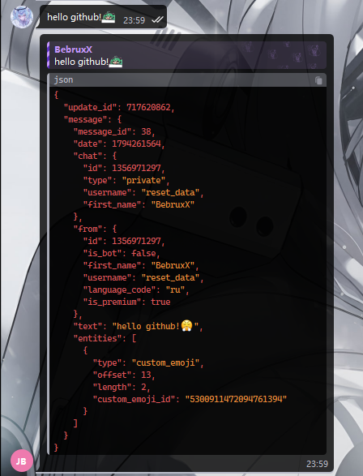
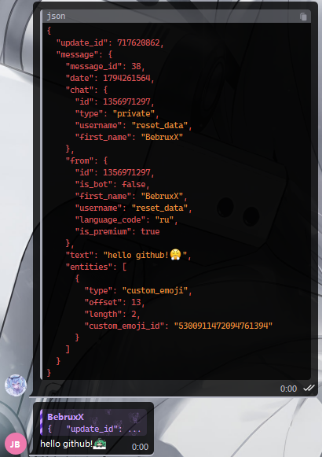

# JSON Help Bot

A Telegram bot written in Python: it converts messages into the raw JSON of a Telegram update and builds messages back from that JSON. Text and media are supported.

## Screenshots

| Message → JSON | JSON → message |
|:---:|:---:|
|  |  |

## Features

- **Message → JSON.** The bot returns the original Telegram update as JSON, including `update_id`, `from`, `chat`, `date` (Unix timestamp), `forward_origin`, `forward_from`, `forward_date`, `entities` and the other fields.
  If the JSON does not fit into one message, the bot sends a `message_<id>.json` file.
- **JSON → message.** Accepts a Telegram update JSON (with a `message` object) or a bare message object, pasted as text or uploaded as a `.json` file.
- **Media.** Photos, videos, animations, audio, voice messages, documents, stickers and video notes via a `file_id` from the Telegram JSON or a direct `url`.
- **Content types.** Text, location, venue, contact, poll, dice.
- **Commands.** `/start`, `/help`, `/json` (JSON of the message you reply to).

## Project structure

```
jsonhelpbot/
├── jsonhelpbot/
│   ├── __main__.py              # python -m jsonhelpbot
│   ├── main.py                  # bot setup and polling
│   ├── config.py                # reads BOT_TOKEN from .env
│   ├── texts.py                 # /start and /help texts
│   ├── handlers/
│   │   ├── common.py            # commands
│   │   └── convert.py           # message ↔ JSON routing
│   ├── serializers/
│   │   ├── schema.py            # content type constants
│   │   ├── message_to_json.py   # Update/Message → dict
│   │   └── json_to_message.py   # dict → Bot API call
│   └── utils/
│       ├── json_tools.py        # JSON parsing and dumping
│       └── replies.py           # JSON reply (text or file)
├── images/                      # README screenshots
├── tests/                       # pytest
├── .env.example
├── requirements.txt
├── requirements-dev.txt
└── pyproject.toml
```

## Quick start

You need Python 3.10+ (tested on 3.12).

```powershell
python -m venv .venv
.venv\Scripts\Activate.ps1
pip install -r requirements-dev.txt
Copy-Item .env.example .env
notepad .env
```

Put the token from [@BotFather](https://t.me/BotFather) into `.env`:

```
BOT_TOKEN=123456789:AA...
```

Run:

```powershell
python -m jsonhelpbot
```

## Tests

```powershell
pytest
```

The tests do not use the network: they cover serializing updates to raw JSON, building Bot API calls and parsing JSON.

## JSON format

### Message → JSON

The bot returns exactly what Telegram sent, with no custom schema. Example automatic reply:

```json
{
  "update_id": 717620862,
  "message": {
    "message_id": 38,
    "date": 1794261564,
    "chat": {
      "id": 1356971297,
      "type": "private",
      "username": "reset_data",
      "first_name": "BebruxX"
    },
    "from": {
      "id": 1356971297,
      "is_bot": false,
      "first_name": "BebruxX",
      "username": "reset_data",
      "language_code": "ru",
      "is_premium": true
    },
    "text": "hello github!🤯",
    "entities": [
      {
        "type": "custom_emoji",
        "offset": 13,
        "length": 2,
        "custom_emoji_id": "5300911472094761394"
      }
    ]
  }
}
```

Dates are Unix timestamps, as in the Bot API. Fields with a `null` value are omitted.

### JSON → message

You can send a full update (the bot uses its `message` object) or just a message object. The content type is detected from the message fields.

| Content | Field |
|---|---|
| Text | `text` |
| Photo | `photo` — an array of sizes; the largest one is sent |
| Video / animation / audio / voice / document / sticker / video note | the field of the same name |
| Location | `location` |
| Venue | `venue` |
| Contact | `contact` |
| Poll | `poll` |
| Dice | `dice` |

Examples:

```json
{"text": "Hello"}
```

```json
{
  "message": {
    "message_id": 10,
    "date": 1700000000,
    "chat": {"id": 1, "type": "private"},
    "from": {"id": 1, "is_bot": false, "first_name": "A"},
    "text": "Hello from an update"
  }
}
```

```json
{
  "photo": [
    {
      "file_id": "AgACAgIAAxkBAAI...",
      "file_unique_id": "AQAD...",
      "width": 1280,
      "height": 960
    }
  ],
  "caption": "A cat"
}
```

```json
{
  "photo": {"url": "https://example.com/cat.jpg"},
  "caption": "A cat from the internet"
}
```

```json
{
  "location": {"latitude": 55.7522, "longitude": 37.6156}
}
```

```json
{
  "poll": {
    "question": "Shall we go for a walk?",
    "options": [{"text": "Yes"}, {"text": "No"}],
    "is_anonymous": true,
    "allows_multiple_answers": false
  }
}
```

```json
{"dice": {"emoji": "🎲"}}
```

When sending, metadata (`update_id`, `message_id`, `date`, `chat`, `from`, `forward_origin`, etc.) is optional and does not affect the result. A forward is not restored as a forward: its content is sent as a regular message.

### Media and `file_id`

A `file_id` from JSON is valid only in this bot. To send media elsewhere or from another bot, replace the media object with `{"url": "https://..."}` pointing directly to the file.
For photos you can replace either the whole array or one of its items with an object containing `url`.

The bot does not download the original file: it sends media by `file_id`/`url` through the Bot API.

## Commands

- `/start` — a short overview.
- `/help` — detailed instructions.
- `/json` — reply to any message with this command to get its raw JSON. The `update_id` of a replied-to message is not available, so only the message object is returned.

## Limitations

- Keyboards, inline buttons, reactions and service updates are not transferred.
- A forward is sent as a regular message (forward fields are not restored).
- A dice is rolled anew when sent.
- A poll is created anew: old votes and `is_closed` are not transferred; a quiz needs `correct_option_id`.
- Media by `file_id` works only in this bot.
- Telegram limits a message to 4096 characters, so long JSON is sent as a file.
- A JSON input file can be up to 5 MB and must be UTF-8 encoded.

## License

Educational/internal project, use it however you like.
